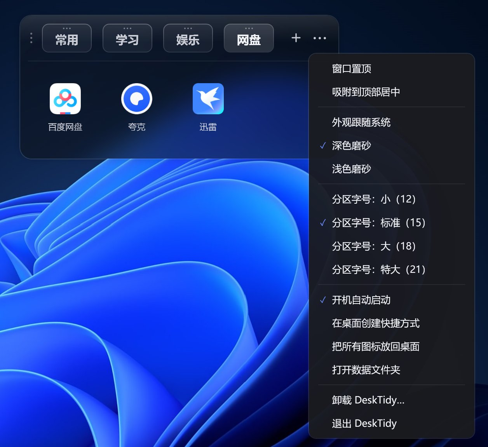

# DeskTidy

**给 Windows 桌面做分区的极简小工具 —— 吸附在屏幕顶部，把快捷方式按类别归位。**

> 🤖 本项目由 AI 辅助开发：需求与设计由作者主导，代码主要由 AI 生成。

[](LICENSE)
[]()
[]()



## 功能

- **顶部吸附** — 一条细长的分区条，点开是图标网格，桌面本身保持干净
- **双向拖拽** — 桌面文件拖进来真移动，拖出去原样搬回
- **桌面挂件** — 平时沉在所有窗口最下层，不遮挡任何程序；点它浮上来，点桌面空白沉下去
- **显示桌面不消失** — 按 Win+D 或点任务栏右下角，分区条依然留在桌面上
- **跟手拖动** — 拖分区时胶囊贴着鼠标走，走到位才换位
- **磨砂外观** — 用当前壁纸模糊做底，换壁纸自动更新；深 / 浅两套主题，四档字号
- **轻** — 单文件 271 KB，待机 CPU 0.00%，无后台轮询
- **零依赖** — 只需 .NET 8 桌面运行时

## 1.1.0 更新

| 改动 | 说明 |
| --- | --- |
| **窗口沉到最下层** | 不再和其他窗口平级，常驻桌面之上、所有程序之下 |
| **显示桌面不消失** | 把窗口挂到桌面壁纸窗口（`WorkerW`）名下，桌面被抬起时跟着一起上去 |
| **点它浮起 / 点桌面沉底** | 用的时候浮到最上层，切走就沉回去 |
| **换壁纸自动刷新** | 之前磨砂底图只在启动时读一次，换壁纸后一直用旧图 |
| **拖动跟手** | 之前胶囊不跟鼠标、只在阈值处跳一格；现在贴着指针走，按边缘对齐换位 |
| **移除「常驻置顶」** | 与最下层互斥，永远无效，直接从设置里去掉 |
| **单文件发布** | 不再需要和 `.dll` 放在一起 |

## 下载安装

**[⬇ 下载 DeskTidy-1.1.0.zip](https://github.com/youyou2858/DeskTidy/releases/download/v1.1.0/DeskTidy-1.1.0.zip)**（约 140 KB）

1. 解压到任意文件夹
2. 双击 `DeskTidy.exe`（就这一个文件，不需要额外的 `.dll`）

> 旧版本仍可下载：[DeskTidy-1.0.0](https://github.com/youyou2858/DeskTidy/releases/tag/v1.0.0)

> 需要 [.NET 8 桌面运行时](https://dotnet.microsoft.com/download/dotnet/8.0)，Windows 10 / 11。

## 操作速查

| 操作 | 说明 |
| --- | --- |
| 展开 / 收起分区 | 左键点分区胶囊 |
| 新建分区 | 点右上角 `+`，输入名字回车 |
| 重命名 / 删除分区 | 右键分区胶囊 |
| 添加图标 | 从桌面拖进展开的面板，或直接拖到分区胶囊上 |
| 移出图标 | 拖到桌面或任意文件夹 |
| 排序 | 面板内拖动图标；拖分区框上方的三个横点可调整分区顺序 |
| 选中 | 单击；`Ctrl` 点多选；空白处拖动可框选；`Ctrl+A` 全选 |
| 打开 | 双击 |
| 删除 | 选中后按 `Delete`（托管文件进回收站，可还原） |
| 右键图标 | 打开 / 打开方式 / 复制 / 剪切 / 创建快捷方式 / 重命名 / 放回桌面 / 移除 / 属性 |
| 设置 | 点右上角 `⋯`（主题、字号、开机自启、卸载等） |
| 移动窗口 | 按住最左侧的三个竖点拖动 |
| 托盘 | 双击唤回窗口；右键菜单含开机自启 |

> 快捷键：`Delete` 删除、`Ctrl+A` 全选、`Esc` 取消选中或关闭菜单。

## 安全设计

**不会弄丢你的程序**，设计上做了三层保护：

1. **只搬快捷方式** — 从桌面拖进来的 `.lnk` / `.url` 会被移入 `Library\`；
   `.exe` 和文件夹**只做引用，原文件一个字节都不动**（移动 exe 很容易弄坏绿色软件）
2. **拖出去是临时快捷方式** — 交给 Explorer 的是 `%TEMP%` 里几 KB 的副本，
   不是你的 exe 本体，绝不可能把程序搬走
3. **删除有内容的分区会先提示** — 确认后内容会被放回桌面，程序不会丢

数据存在 `%APPDATA%\DeskTidy\`（`data.json` + `Library\`）。
卸载走菜单里的「卸载 DeskTidy…」，会先引导你把图标放回桌面，放不干净就中止。

## 常见问题

**杀软报毒？**
程序没有数字签名，但**没有任何联网行为**。加入信任区即可。

**1.1 改成单文件了？**
是。托管单文件不会自解压到临时目录，程序和依赖直接映射进内存，所以不用担心"释放器"式的误杀。

**托盘图标找不到？**
Win11 默认把新图标收进任务栏的 `^` 里，拖到任务栏固定一次即可。

**为什么右键菜单不是 Win11 那种紧凑样式？**
那套菜单是 Explorer 私有的 XAML 实现，第三方拿不到，只能自绘。

## 从源码构建

```bash
git clone https://github.com/youyou2858/DeskTidy.git
cd DeskTidy
dotnet build -c Release
dotnet publish -c Release -r win-x64 --self-contained false -p:PublishSingleFile=true -o publish
```

产物是单个 `publish/DeskTidy.exe`。需要 [.NET 8 SDK](https://dotnet.microsoft.com/download/dotnet/8.0)。

```
DeskTidy/
├── MainWindow.xaml(.cs)   主窗口 · 分区 · 拖拽 · 右键菜单
├── TrayIcon.cs            原生托盘图标（Shell_NotifyIcon）
├── ShellMenu.cs           调用系统右键菜单
├── Frost.cs               壁纸模糊底图
├── DesktopMode.cs         窗口层级：沉底 / 浮起 / 显示桌面跟随
├── IconCache.cs           图标提取与缓存
├── Shortcut.cs / Storage.cs / AutoStart.cs
├── Native.cs              Win32 P/Invoke
└── Theme/                 深色 / 浅色主题
```

## 许可证

[MIT](LICENSE) © 2026 youyou2858
